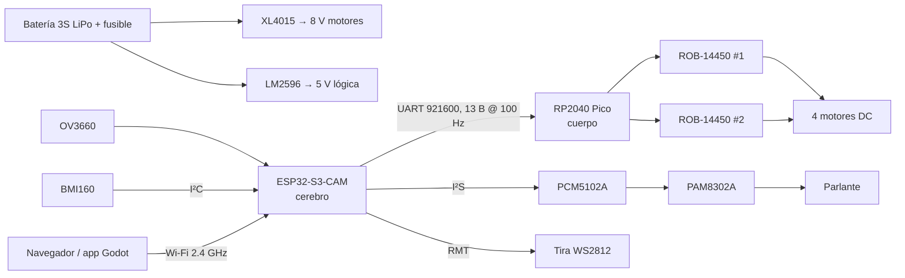

# usbbog-realidad-mixta

Carro robot 4×4 teleoperado por Wi-Fi, con cámara, audio, IMU e iluminación
direccionable. El repositorio reúne el firmware de los dos microcontroladores, la
electrónica, la aplicación de control en Godot y el informe del proyecto en LaTeX.

## Arquitectura

El coche se divide en **cerebro** y **cuerpo**:

| Placa | Papel |
| --- | --- |
| **ESP32-S3-CAM N16R8** | Cerebro: SoftAP, cámara OV3660, audio I²S, IMU BMI160, tira LED WS2812, servidor HTTP/UDP y mezcla de tracción. Gobierna los motores a través de un enlace UART a 100 Hz. |
| **Raspberry Pi Pico (RP2040)** | Cuerpo: convierte cuatro consignas firmadas en 4 × PWM de 20 kHz, 8 líneas de dirección y `STBY` para dos drivers TB6612FNG. No decide nada; solo ejecuta y protege. |



Todo lo que decide ocurre en el ESP32-S3; el Pico es un ejecutor con sus propias
protecciones. El control es **teleoperado**: la IMU se publica y se muestra, pero
todavía no gobierna los motores.

## Funcionalidades

### Control de movimiento

- **Tracción en cuatro ruedas** mediante mezcla diferencial: `th` (adelante/atrás),
  `turn` (giro) y `twist` (reparto delante/detrás), cada uno en per-mille ±1000.
- **Direcciones verificadas en el coche**: `th +` avanza y `turn +` gira a la
  izquierda. Al retroceder, el sentido del giro se invierte para que `turn +` siga
  girando a la izquierda tal como se ve desde fuera.
- **Modo de prueba de ruedas**: cuatro consignas crudas `fl`/`rl`/`rr`/`fr`, sin
  mezcla, para comprobar un canal cada vez.
- **Tres formas de parar**: `brake` (por defecto, frena), `coast` (rueda libre) y
  `disable` (baja `STBY`, drivers desenergizados).
- **Cadena de seguridad**:
  - Enlace UART1 a **921600 8N1**, tramas de 13 bytes a **100 Hz** con CRC-8 y
    búsqueda de sincronía.
  - **Dead-man del Pico: 200 ms** sin comandos de movimiento → `STBY` low y salidas
    en alta impedancia.
  - **Watchdog del cerebro: 400 ms** sin `/drive` → `BRAKE`. Cubre el caso que el
    dead-man no ve: el teléfono se durmió o salió del Wi-Fi mientras el cerebro
    sigue enviando la última consigna.
  - **Límite de pendiente** de ±100 per-mille por trama: una trama mala no puede
    ordenar un cambio de full-scale.
  - Arranque en `DISABLE`: los motores no se energizan hasta que llega un comando.
- **Paro de emergencia opcional** (contacto NC sobre `STBY`) previsto en el
  esquema.

### Video

- Cámara **OV3660** en el conector FPC de la placa, sin cableado adicional.
- **VGA (640×480) JPEG**, calidad 12, búferes en PSRAM y `CAMERA_GRAB_LATEST`
  (siempre se envía el cuadro más reciente, no una cola de cuadros viejos).
- **MJPEG por HTTP en el puerto 81** (`GET /stream`), con su propio servidor para
  que la transmisión no bloquee el resto de endpoints.
- **Foto instantánea** con `GET /capture`.
- **Video de baja latencia por UDP en el puerto 82**: el cliente envía `BV1 SUB`
  cada ~500 ms y recibe JPEG fragmentados con cabecera de 20 bytes. Un fragmento
  perdido descarta solo ese cuadro; nunca se decodifica un cuadro incompleto.
  La misma suscripción transporta las muestras de IMU.
- **Ajustes de cámara en caliente** por `/control`: `framesize`, `quality`,
  `brightness`, `contrast`, `saturation`, `hmirror` y `vflip`. La orientación
  vertical se corrige al arrancar porque el sensor va montado rotado.

### IMU y orientación

- **BMI160** en I²C (dirección `0x69`), muestreado a **200 Hz** en una tarea
  propia del núcleo 1.
- Publica aceleración, velocidad angular, **pitch/roll**, temperatura, número de
  secuencia y errores de lectura.
- **Comprobación de gravedad al arrancar**: una placa quieta debe leer 1 g; el
  firmware lo informa y aplica la corrección de escala necesaria.
- `GET /imu` entrega la última muestra en JSON; la página web la consulta a 15 Hz.
- La app Godot recibe las muestras por **UDP a 50 Hz** y dibuja un **horizonte
  artificial** proyectado con la FOV horizontal medida de 45°.
- El giroscopio se lee, pero la integración de yaw todavía no se usa para
  odometría ni para un lazo de control autónomo.

### Audio

- Cadena **I²S → PCM5102A → amplificador clase D PAM8302A → parlante**.
- **22050 Hz, 16 bits, mono**; los clips van compilados en `firmware.bin` como
  muestras PCM, sin sistema de archivos ni decodificador en tiempo de ejecución.
- **Ocho sonidos disponibles** bajo demanda: los tonos de prueba (`beeps`) y los
  siete clips `clip`, `kachao1`, `kachao2`, `kachao3`, `rapido`, `ganadora` y
  `velocidad`.
- **Nada se reproduce solo**: el coche arranca en silencio y solo suena cuando se
  pide desde la página, la app o `/play`.
- **Reproducción en tarea aparte**, para que `i2s_write()` no congele el video.
  Un sonido nuevo reemplaza al anterior en el siguiente límite de búfer.
- **Volumen maestro en per-mille** (`0..1000`, es decir 0–100 %), por defecto
  **3,66 %** (≈ −29 dBFS). Se puede cambiar con `/control?vol=N` sin reproducir
  nada, o junto con un sonido con `/play?src=...&vol=N`. La página ofrece niveles
  preajustados de 1/2/5/10/20 %; la app Godot abre un deslizador de 0–100 %.
- `tools/build_audio.py` convierte los originales de `audio/` a PCM y regenera la
  tabla de clips. Los archivos generados se versionan.

### Iluminación

- **Tira WS2812 de 29 píxeles** controlada por RMT en `GPIO48` (no PWM: el timing
  de un WS2812 se corrompe con PWM). Se refresca cada 30 ms.
- **Grupos con nombre**:

  | Grupo | Píxeles |
  | --- | ---: |
  | `tail_right` | 2 |
  | `tail_centre` | 4 |
  | `tail_left` | 2 |
  | `floor` | 17 |
  | `head_left` | 2 |
  | `head_right` | 2 |

- **Luces de posición**: `base=low` (por defecto, faros blancos y traseras rojas
  a 20/255), `base=high` (128/255, luces altas) y `base=off`.
- **Balizas**: `hazard=1` hace parpadear las luces laterales en ámbar a ~1,25 Hz.
- **Suelo arcoíris**: `rainbow=1` recorre la rueda de color en el grupo `floor`;
  viene encendido por defecto.
- **Escena manual** por grupo (`group=<nombre>&r/g/b`) o para toda la tira
  (`led_r/g/b`). Las escrituras por grupo componen sobre la escena manual: se
  puede pintar toda la tira de rojo y después cambiar solo el suelo a azul.
- `hazard` y `rainbow` son **independientes** de `base` y se superponen a ella;
  funcionan incluso con las luces base apagadas.
- **Techo de seguridad de 128/255** para todos los canales. Con los niveles
  configurados, toda la tira encendida consume ~180 mA, dentro del presupuesto de
  un puerto USB 2.0.
- El LED WS2812 de la propia placa está en la misma red y refleja el píxel 0 de
  la tira.

### Interfaz web

La placa crea su propio **SoftAP** (`KAIROS 95` / `carro123` por defecto, canal 1,
hasta 4 clientes, sin salida a Internet) y sirve una página en
`http://192.168.4.1/`.

| Endpoint | Función |
| --- | --- |
| `GET /` | Página de control: video, cruceta de conducción, prueba de ruedas, luces, sonidos, volumen, IMU y estado del enlace. |
| `GET /stream` | Video MJPEG (`multipart/x-mixed-replace`), **puerto 81**. |
| `UDP :82` | Video UDP de baja latencia + muestras de IMU a 50 Hz. Suscripción con `BV1 SUB`. |
| `GET /capture` | Una foto JPEG. |
| `GET /status` | JSON con heap, PSRAM, clientes, fps, audio, volumen, clips, ajustes del sensor, estado de luces y estado del enlace con el Pico. |
| `GET /imu` | Última muestra de la IMU en JSON. |
| `GET\|POST /play` | `?src=beeps\|<clip>` y opcionalmente `&vol=0..1000`. Responde de inmediato. |
| `GET\|POST /control` | Ajustes de cámara, luces (`base`, `hazard`, `rainbow`, `group`, `led_r/g/b`) y volumen (`vol`). |
| `GET\|POST /drive` | Motores: `?th=&turn=&twist=` (mezcla) o `?fl=&rl=&rr=&fr=` (cuatro consignas crudas). |
| `GET\|POST /stop` | `?mode=brake` (por defecto), `coast` o `disable`. |

La página reenvía `/drive` a 10 Hz mientras se mantiene un control, usa eventos de
puntero con captura (un dedo que se sale del botón no deja el coche acelerando) y
acepta teclado (flechas/WASD). El endpoint `/stream` vive en otro puerto porque su
handler no retorna mientras hay un cliente mirando; compartir el puerto 80
bloquearía `/play`, `/status` y `/control` durante el video.

### Aplicación Godot

`game-app/` es una aplicación **Godot 4.7** (GL Compatibility) para PC o móvil:

- Conexión al coche por **UDP** (video + IMU) y reconexión automática ante corte o
  estancamiento.
- **Dos sticks virtuales simultáneos**: la base aparece donde cae el dedo, con
  zona muerta y eje restringido (acelerador vertical, dirección horizontal).
- **HUD de actitud**: horizonte artificial, escala de banco y lectura de pitch/roll.
- **Galería de sonidos** construida desde `clips[]` de `/status`, con indicador de
  "reproduciendo" y control de **volumen 0–100 %**.
- **Luces**: off / low / high, hazard y rainbow, leyendo siempre el estado real de
  la placa.
- **Resolución VGA/QVGA** con lectura de vuelta desde `/status`.
- **Estadísticas** de fps, cuadros descartados y pérdida de fragmentos.
- **Corrección de color** de la imagen de la cámara mediante shader (punto negro,
  gamma, contraste y saturación), sin coste de ancho de banda.
- Al soltar ambos sticks, o al perder el video, envía `/stop` de inmediato.

## Hardware

| Elemento | Función |
| --- | --- |
| ESP32-S3-CAM N16R8 (Freenove) | Cerebro, cámara OV3660, Wi-Fi, audio, IMU y luces. |
| Raspberry Pi Pico (RP2040) | 4 × PWM 20 kHz, 8 líneas de dirección, `STBY`. |
| 2 × SparkFun ROB-14450 | Puentes H duales TB6612FNG. |
| 4 × motor DC + reductora | Tracción 4×4. |
| BMI160 | Acelerómetro + giroscopio de 6 ejes. |
| PCM5102A + PAM8302A | DAC I²S + amplificador de audio. |
| Tira WS2812 5 V (29 píxeles) | Luces de posición, balizas y suelo. |
| Batería 3S LiPo + fusible 7,5 A | Alimentación. |
| XL4015 (5 A) | Riel de motores a 8,0 V. |
| LM2596 (3 A) | Riel lógico de 5,0 V. |

Conexiones principales:

| Señal | ESP32-S3 | Destino |
| --- | --- | --- |
| Enlace UART TX | `GPIO1` | Pico `GP17` |
| Enlace UART RX | `GPIO2` | Pico `GP16` |
| I²S BCK / DIN / LRCK | `GPIO47` / `GPIO21` / `GPIO45` | PCM5102A `BCK` / `DIN` / `LCK` |
| Datos WS2812 | `GPIO48` (vía 330 Ω) | Tira + LED de la placa |
| I²C SDA / SCL | `GPIO41` / `GPIO42` | BMI160 |
| PWM + dirección | Pico `GP0`–`GP15` | ROB-14450 |
| `STBY` | Pico `GP28` (vía 1 kΩ) | Ambos ROB-14450 |

El riel de motores (8 V) y el lógico (5 V) son independientes. La tira WS2812 de
5 V necesita un adaptador de nivel en la línea de datos (74AHCT125 o 74HCT245),
porque su `Vih` de 3,5 V supera los 3,3 V del S3. Los dos buck deben ajustarse y
medirse **antes** de conectar las placas.

La electrónica está en KiCad, generada desde `hardware/gen_schematic.py`:

- [`hardware/car.kicad_sch`](hardware/car.kicad_sch) / [`hardware/car.pdf`](hardware/car.pdf):
  esquema y versión imprimible.
- [`hardware/wiring.md`](hardware/wiring.md): tabla red por red para el montaje.
- [`hardware/README.md`](hardware/README.md): generación, ERC y convenciones.

Es un **plan de conexiones**, no una PCB: no hay footprints ni layout. El ERC de
KiCad está limpio (0 errores, 0 avisos).

## Estructura del repositorio

```
.
├── firmware/
│   ├── brain/                 # ESP32-S3: cámara, audio, IMU, luces, web y enlace
│   ├── pico_body/             # RP2040: PWM, dirección, dead-man y enlace
│   └── car_control/           # Sketch antiguo, conservado como referencia
├── game-app/                  # Aplicación Godot 4.7
├── hardware/                  # Esquema KiCad, PDF y tabla de cableado
├── docs/                      # Plan eléctrico y notas de la ESP32-S3-CAM
├── report/                    # Informe LaTeX
└── README.md                  # Este archivo
```

## Puesta en marcha

### Requisitos

- [PlatformIO](https://platformio.org/) (VS Code o CLI).
- [Godot 4.7](https://godotengine.org/) para la app de control.
- Python 3 + `ffmpeg` solo si se regeneran los clips de audio.
- KiCad 7+ y `kicad-cli` solo para regenerar el esquema.
- Una distribución de TeX (TeX Live / MiKTeX) y `latexmk` o `pdflatex` para el
  informe.

### Firmware

```bash
# Pico: primero el self-test; luego, el modo LINK real
pio run -d firmware/pico_body -t upload
pio run -d firmware/pico_body -e picolink -t upload

# ESP32-S3: cerebro
pio run -d firmware/brain -t upload
pio run -d firmware/brain -t monitor
```

La primera grabación del Pico requiere mantener **BOOTSEL** (o arrastrar
`firmware.uf2` a la unidad `RPI-RP2`). El monitor del cerebro usa el puerto USB
(UART0); el enlace con el Pico va por UART1 en `GPIO1`/`GPIO2`.

### Uso

1. Conectar el PC o teléfono al Wi-Fi **`KAIROS 95`** (contraseña `carro123`; se
   cambia copiando [`secrets.example.h`](firmware/brain/include/secrets.example.h)
   a `secrets.h` y editando ahí SSID y contraseña).
2. Abrir `http://192.168.4.1/`.
3. Para la app: abrir `game-app/project.godot` con Godot 4.7 y ejecutar la escena
   principal.

### Pruebas sin hardware

```bash
cd firmware/brain
g++ -std=gnu++11 -Wall -Wextra -I include -I ../pico_body/include \
    tools/test_link.cpp -o /tmp/test_link
/tmp/test_link
```

Cubren CRC-8, round-trips de todas las tramas, corrupción de cada bit, búsqueda de
sincronía en ruido, mezcla, convención de giro y mapeo de canales: **338
comprobaciones**.

## Ejemplos de API

```bash
# Avanzar y girar a la izquierda
curl 'http://192.168.4.1/drive?th=600&turn=300&twist=0'

# Frenar
curl -X POST 'http://192.168.4.1/stop'

# Tono de prueba al 5 %
curl 'http://192.168.4.1/play?src=beeps&vol=50'

# Luces altas con balizas
curl 'http://192.168.4.1/control?base=high&hazard=1'

# Suelo azul, resto de la tira rojo
curl 'http://192.168.4.1/control?led_r=255&led_g=0&led_b=0'
curl 'http://192.168.4.1/control?group=floor&b=255'

# Cambiar a QVGA
curl 'http://192.168.4.1/control?framesize=qvga'

# Estado completo
curl 'http://192.168.4.1/status'
```

## Documentación detallada

- [`firmware/brain/README.md`](firmware/brain/README.md): decisiones, pines,
  audio, video, luces, IMU y enlace con el Pico.
- [`firmware/pico_body/README.md`](firmware/pico_body/README.md): PWM, dead-man,
  límite de pendiente, autotest y modo LINK.
- [`firmware/README.md`](firmware/README.md): cómo se compilan los proyectos.
- [`docs/circuit-plan.md`](docs/circuit-plan.md): plan eléctrico y de firmware.
- [`hardware/wiring.md`](hardware/wiring.md): cableado neto por neto.
- [`report/README.md`](report/README.md): compilación del informe.

## Alcance y límites conocidos

- El control es **teleoperado**; no hay lazo autónomo ni evitación de obstáculos.
- La IMU alimenta el HUD, pero la integración de yaw todavía no se usa para
  navegación.
- `/stream` (TCP) y el video UDP compiten por los búferes de la cámara: no
  conviene mirar ambos a la vez.
- Si el audio cruje mientras se transmite video, bajar primero `framesize` a
  `qvga`; es contención de ancho de banda de PSRAM, no un fallo del audio.
- El esquema eléctrico está verificado por ERC y netlist, pero no se ha
  convertido en PCB.
