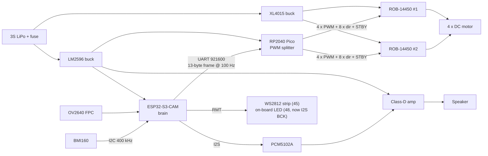

# Circuit plan — ESP32-S3-CAM brain + RP2040 PWM splitter

Companion to `docs/esp32-cam.md` (which contains the full GPIO inventory and the
alternatives that were rejected). This file is the **buildable plan**: one
architecture, one pin map per chip, one frame format, one power tree.

> **Date:** 2026-10-10 · **Status:** agreed architecture, not yet wired.
>
> 🔌 **KiCad version of this plan: [`../hardware/`](../hardware/)** — open
> `car.kicad_pro` for the A2 schematic, or read `car.pdf` without KiCad. The
> schematic is generated from and machine-checked against the tables below, and
> `hardware/wiring.md` is the net-by-net build list. Where the two disagree, the
> schematic is right — it passes ERC, this prose does not.

**The architecture in one sentence:** the ESP32-S3-CAM is the only brain — WiFi,
camera, audio out, BMI160 in, and the entire control loop — while the RP2040 is a
dumb PWM splitter that turns four duty values into the twelve logic lines the two
driver boards need.

> **Driver boards (2026-10-10):** SparkFun **ROB-14450** ×2 — the dual-TB6612FNG
> breakout with pre-soldered headers. Same chip as the bare breakout, so nothing
> electrical changed; the physical header order is now pinned down in §3.3.

| Chip | Role | Firmware |
| --- | --- | --- |
| **ESP32-S3-CAM** (WROOM-1 **N16R8**) | brain / head | Arduino-ESP32: WiFi + camera + I²S + I²C + 100 Hz control loop |
| **RP2040** (Pico) | hands / body | 4 × 20 kHz PWM + 8 direction lines + `STBY`, driven by a 100 Hz link |

Why not the PCA9685 we looked at first: the Pico was what you could actually buy,
it gives real hardware PWM at any frequency, it needs no I²C on the motor side, and
it keeps spare pins for encoders later.



---

## 1. Division of labour

Everything that decides anything happens on the S3. The Pico decides nothing.

| Concern | Owner | Notes |
| --- | --- | --- |
| WiFi / REST / telemetry to the Godot app | S3 | `game-app/scenes/bars_client.gd` already talks HTTP |
| Camera capture + streaming | S3 | OV2640 on the on-board FPC, PSRAM framebuffers |
| Audio playback | S3 | I²S out → PCM5102A |
| IMU read | S3 | BMI160 on I²C, 200 Hz gyro / 100 Hz accel |
| **Control law, mixing, ramping, braking** | **S3** | 100 Hz task, pinned to one core |
| PWM generation | Pico | 20 kHz hardware PWM, 4 channels |
| Direction logic (sign of the duty) | Pico | derived from the frame, no state machine |
| Dead-man switch | Pico | drops `STBY` 100 ms after the last valid frame |
| Encoders, battery sense | nobody yet | Pico's spare pins if you add them (§13) |

**Why the split works:** the S3 needs 7 pins for its own peripherals and simply
does not have the 13 that four motors in "3 pins each + `STBY`" mode demand. The
Pico does, and it costs two S3 pins (the UART link) to hand them over.

---

## 2. ESP32-S3-CAM pin map

**Everything lives on the right header row. The left row is untouched — it stays
100 % camera.**

| Function | GPIO | Header | Wire notes |
| --- | --- | --- | --- |
| UART TX → Pico RX | **43** | right #1 | U0TXD; 3.3 V, no level shifting |
| UART RX ← Pico TX | **44** | right #2 | U0RXD |
| I²C SDA → BMI160 | **1** | right #3 | 4.7 kΩ pull-up to 3V3 |
| I²C SCL → BMI160 | **2** | right #4 | 4.7 kΩ pull-up to 3V3 |
| I²S `BCK` | **48** | right #15 | direct — the DAC board has its own series resistors |
| I²S `DIN` | **47** | right #16 | direct |
| I²S `LRCK` / `WS` | **21** | right #17 | direct |
| **LED strip data** | **45** | right #14 | RMT channel 1; 330–470 Ω series, level shifter for a 5 V strip |
| on-board WS2812 | (**48**) | right #15 | **now shared with I²S `BCK`** — no buffer, so it follows the bit clock and is no longer a status light (§2.1) |
| spare → **microSD** | 38, 39, 40 | right #9–#7 | the on-board slot: `CMD` / `CLK` / `DATA` — freed by this I²S move |
| spare → **JTAG** | 39–42 | right #8–#5 | debug over the header; shares `39`/`40` with the SD slot |
| **not used** | 3, 46 | left #12, left #13 | left floating — see §2.2 |
| **not used** | 0, 19, 20 | right #13, #19, #18 | BOOT button + USB, untouched |

### 2.1 Why I²S moved to `48` / `47` / `21`

`48`, `47` and `21` are header positions **#15, #16, #17** — three *adjacent* pins — and
the signals are assigned in the same top-to-bottom order as the DAC board's own left
header (`BCK`, `DIN`, `LCK`). A three-way ribbon therefore runs straight across with no
crossings, which is the whole reason this trio is worth having:

| Header | GPIO | I²S signal | DAC pad |
| --- | --- | --- | --- |
| right #15 | **48** | `BCK` | `2` |
| right #16 | **47** | `DIN` | `3` |
| right #17 | **21** | `LRCK` | `4` |

The S3 routes I²S through its **GPIO matrix**, so *any* pin can carry *any* I²S signal.
There is no hardware restriction to work around here — only a wiring one.

**What it costs: the on-board WS2812.** `GPIO48` *is* the data input of the on-board
addressable LED — the header pin and the LED are the same net, with no buffer. Feed a
bit clock through it and the LED follows that clock. Because `BCK` is a continuous
2.8 MHz clock with no idle-low gaps, the LED's own protocol decoder never sees the
reset pulse it needs to latch, so in practice it tends to sit dark rather than flicker
— but either way it is now out of your control. **If you want a status light on this
build, it has to be an external one**, on the strip's data line.

**What it buys:**

* **`38` / `39` / `40` come back as the on-board microSD slot** (`CMD` / `CLK` /
  `DATA`). The old map put I²S `DIN` on `40`, which is that slot's `DAT0`, so the slot
  was foreclosed outright. It no longer is.
* **`39`–`42` come back as JTAG** (`MTCK` / `MTDO` / `MTDI` / `MTMS`). The old map
  used `40`, `41` and `42`, which blocked hardware debugging over the header entirely.
  Note the SD slot and JTAG **share `39` and `40`**, so it is one or the other rather
  than both.

**The strip moves to `45`** (right #14, immediately beside the new I²S trio). `45` is
the `VDD_SPI` strapping pin, so this does reintroduce one strapping pin into the map
(§2.2) — but the risk is genuinely low, and the reason is worth stating precisely: a
WS2812's data input is **high-impedance**, so it cannot fight the pin's internal
~45 kΩ pull-down; that pull-down is what selects `VDD_SPI = 3.3 V`, which is the
correct value; and the strap is sampled **at reset**, long before the RMT peripheral
starts driving. The strip sees a moment of garbage during boot and then settles.

> If you would rather not spend `45`, drop the strip: `48` cannot become a status LED
> again while it carries `BCK`, but `45` goes back to being unused.

Left row (all camera, for reference): `4, 5, 6, 7, 15, 16, 17, 18, 8, 3, 46, 9, 10,
11, 12, 13, 14` plus 3V3 / RST / 5V.

### 2.2 Why this is the safest pin map we've had

### 2.2 Strapping pins: what is touched, and why it is still safe

Four pins on this chip decide how it boots: `0`, `3`, `45` and `46`. **No strapping pin
decides anything in this plan.** The only one touched at all is `45`, and it carries a
*strip data output* that is irrelevant at reset — see §2.1 for why. So the boot and
flash behaviour of the board is exactly what Freenove shipped:

| Strap | Datasheet default with the pin floating | Result |
| --- | --- | --- |
| `0` | weak **pull-up** → 1 | SPI boot |
| `3` | floating | JTAG source: either value is harmless |
| `45` | weak **pull-down** → 0 | `VDD_SPI = 3.3 V` ✔ (matches the 3.3 V flash) |
| `46` | weak **pull-down** → 0 | ROM messages print; with `0` low, download boot works |

Source: ESP32-S3 datasheet v2.2, *Table 3-1 Default Configuration of Strapping Pins*.
The internal pull-downs are weak (~45 kΩ) but nothing is driving those nets, so
they hold. **No external resistors are needed** — if you want belt-and-braces, one
10 kΩ from `45` to GND costs 0.33 mA and removes the last theoretical risk.

> ⚠️ **`46` has a second job: chip boot mode.** `GPIO0 = 0` **and** `GPIO46 = 0`
> gives joint download boot (USB/UART) — what the BOOT button needs. **Never let
> another chip drive `46` high at reset**, or the BOOT button stops working. This
> plan leaves `46` alone, which is exactly why I²S moved to the right row.

### 2.3 Two things to expect on `43` / `44`

* The ROM bootloader prints its banner on `43` at 115200 during every boot. The
  Pico will see ~30 bytes of garbage before the app starts — the frame header +
  CRC handle that, no special code needed.
* The S3's ROM listens on `44` for download-mode handshakes. The Pico's TX is
  idle-high, which is what an unconnected line looks like, so there is no risk
  from the link itself.

---

## 3. RP2040 (Pico) pin map

| GPIO | Function | Peripheral | Notes |
| --- | --- | --- | --- |
| **GP0** | ROB-14450 **#1** `PWMA` | PWM slice 0A | `JP2-1` |
| **GP1** | #1 `AIN1` | plain GPIO | `JP2-3` |
| **GP2** | #1 `AIN2` | plain GPIO | `JP2-2` |
| **GP3** | #1 `BIN2` | plain GPIO | `JP2-6` |
| **GP4** | #1 `BIN1` | plain GPIO | `JP2-5` |
| **GP5** | #1 `PWMB` | PWM slice 2B | `JP2-7` |
| **GP6** | ROB-14450 **#2** `PWMA` | PWM slice 3A | `JP2-1` |
| **GP7** | #2 `AIN1` | plain GPIO | `JP2-3` |
| **GP8** | #2 `AIN2` | plain GPIO | `JP2-2` |
| **GP9** | #2 `BIN2` | plain GPIO | `JP2-6` |
| **GP10** | #2 `BIN1` | plain GPIO | `JP2-5` |
| **GP11** | #2 `PWMB` | PWM slice 5B | `JP2-7` |
| free | GP12–GP15 | | 4 pins — encoders, anything |
| **GP16** | **UART0 TX** → S3 `44` | UART0 (F2) | |
| **GP17** | **UART0 RX** ← S3 `43` | UART0 (F2) | |
| free | GP18–GP22 | | 5 pins — encoders, anything |
| free | GP25 | LED | **plain Pico only** — on a Pico W the LED belongs to the radio |
| free | GP26, GP27 | ADC0, ADC1 | battery voltage / current sense |
| **GP28** | `STBY` (both chips) | plain GPIO | via 1 kΩ, see §9 |

**15 of the 26 exposed GPIOs are used; 11 are free** (`GP12`–`GP15`, `GP18`–`GP22`,
`GP26`, `GP27`), plus the on-board `GP25` LED on a non-W Pico. Note that spending `GP28`
costs **ADC2**, so only `ADC0` and `ADC1` remain for analog work — enough for a battery
divider, which needs one.

**Why the link is on `GP16`/`GP17` and not `GP14`/`GP15`.** UART0's TX/RX is routable
only to **`GP0`/`GP1`**, **`GP12`/`GP13`**, **`GP16`/`GP17`** and **`GP28`/`GP29`**. On
`GP14` and `GP15` the peripheral wires up its *flow-control* pair instead — `GP14` is
`UART0 CTS` and `GP15` is `UART0 RTS` — so those two pads cannot carry the link with the
hardware UART at all. A **PIO UART can run on any pin**, and at this link's load it would
be easy (13 bytes at 100 Hz is 1.4 % of 921600 baud), but it would put PIO assembly
between the dead-man switch and the S3. On a fail-safe link, fewer moving parts wins.
`GP16`/`GP17` is the next genuine UART0 pair.

The cost is visible in the free-pin list above: `GP14`–`GP22` used to be one 9-pin
block, and it is now split into `GP12`–`GP15` and `GP18`–`GP22`. Worth knowing before
choosing where the encoders go.

**Why each driver gets a contiguous 6-pin block.** `#1` takes `GP0`–`GP5` and `#2` takes
`GP6`–`GP11`, in *the same order*: `PWMA`, `AIN1`, `AIN2`, `BIN2`, `BIN1`, `PWMB`. The
B pair is deliberately reversed relative to the A pair, so the two harnesses come out as
mirror images of each other — which is what two driver boards mounted left and right
actually want. It also gives one ribbon per driver with no crossings along its length.

### 3.1 PWM arithmetic (exact)

`f_pwm = f_clk_sys / (clkdiv × (TOP + 1))`, default `f_clk_sys = 125 MHz`:

```
clkdiv = 1        TOP = 6249
f_pwm  = 125 000 000 / 6250 = 20 000 Hz
steps  = 6250     → 12.6 bits of resolution
level  = |duty| × 6250 / 1000        (duty is ±1000 permille)
level  = 6250    → 100 % (always high; used for the coast state)
```

**Four slices, not two.** `GP0` → slice 0A, `GP5` → slice 2B, `GP6` → slice 3A,
`GP11` → slice 5B. Under the old pin order each chip's `PWMA`/`PWMB` shared a slice;
the new order gives every PWM its own. That changes nothing electrically — all four must
carry the same `clkdiv` and `TOP` — but it does mean the firmware configures **four**
slices instead of two. Set the same values on all four and the motors are inaudible;
configure only two and the other pair runs at the reset defaults, which is the mistake to
watch for. Use the SDK calls (`pwm_set_clkdiv`, `pwm_set_wrap`, `pwm_set_chan_level`,
`pwm_set_enabled`) rather than `analogWriteFreq()`, which configures the slices globally
and obscures the wrap.

### 3.2 TB6612 mode table (from the datasheet, verified)

| `AIN1` | `AIN2` | `PWM` | Mode | `OUT1` / `OUT2` |
| --- | --- | --- | --- | --- |
| H | H | H or L | **short brake** | L / L |
| L | H | H | reverse | L / H |
| L | H | L | short brake | L / L |
| H | L | H | forward | H / L |
| H | L | L | short brake | H / L → L / L |
| **L** | **L** | **H** | **stop (coast)** | high-Z |
| any | any | any | `STBY` = L → standby | high-Z |

So the splitter's four states map like this:

| Command | IN1 | IN2 | PWM level |
| --- | --- | --- | --- |
| forward, duty `d` | H | L | `d` |
| reverse, duty `d` | L | H | `d` |
| **coast** (duty = 0) | L | L | 6250 (100 %) |
| **brake** (explicit) | H | H | any |
| **standby** | — | — | — (`STBY` low) |

Note the asymmetry that bites people: *coast* needs `PWM` held **high**, not low.
Driving `PWM` low with both `IN` pins low is not the datasheet's "stop" row.

During normal driving the PWM low-phase is a **short brake**, which is what you want
on a small car (it stops faster than coasting).

### 3.3 The driver boards: SparkFun **ROB-14450**

**Part:** SparkFun *Motor Driver – Dual TB6612FNG (with headers)*, SKU **ROB-14450**,
×2. Earlier drafts said "a TB6612FNG breakout" generically — same **TB6612FNG chip**,
so every electrical finding above and in §9 still holds, but this is the specific
board and its physical layout is what you wire to.

Header order, **verified from SparkFun's own Eagle source**
(`github.com/sparkfun/Motor_Driver-Dual_TB6612FNG`, `Hardware/…_v11.sch`), not read
off a photo:

| `JP1` — outputs & power | `JP2` — inputs |
| --- | --- |
| 1 `GND` | 1 `PWMA` |
| 2 `B01` | 2 `AIN2` |
| 3 `B02` | 3 `AIN1` |
| 4 `A02` | 4 `STBY` |
| 5 `A01` | 5 `BIN1` |
| 6 `GND` | 6 `BIN2` |
| 7 `VCC` | 7 `PWMB` |
| 8 `VM` | 8 `GND` |

Exactly as the product page describes: *"the pins are arranged such that input pins
are on one side and output pins are on the other"*. The silkscreen calls the outputs
`A01` / `A02` / `B01` / `B02` — **not** `AO1` — if you go looking for them.

**What the board gives you for free:**

* **Decoupling on both supply lines** — 0.1 µF + 10 µF on `VM`, 0.1 µF on `VCC`
  (C1, C3, C2 in the schematic). Do **not** add a second 100 nF per pin; do keep the
  **470 µF bulk on `VM`**, which the board does not have and which carries motor
  inrush.
* **Pre-soldered 0.1" headers** — nothing to solder, nothing extra to buy.
* **All 16 pins broken out, including three grounds** (`JP1-1`, `JP1-6`, `JP2-8`).
  Wire all three; the KiCad schematic does.
* **No on-board regulator, and no pull-up on `VCC` or `STBY`.** `VCC` must be
  supplied — from the Pico's 3V3, §7.1 — and `STBY` leans entirely on the chip's
  internal 200 kΩ pull-down. The Eagle netlist confirms there is **no external
  resistor on the `STBY` net**, so §9's fail-safe chain is unchanged.

`PWM` inputs accept up to 100 kHz, so 20 kHz is comfortably inside spec.

---

## 4. The S3 → Pico link

**Physical:** one UART crossover, 2 wires + common ground. Both ends are 3.3 V, no
level shifter.

**Settings:** `921600 8N1`. A 13-byte frame takes ~141 µs; at 100 Hz that is 1.4 %
of the link, so you could push to 500 Hz if a loop needs it.

### 4.1 S3 → Pico frame (13 bytes)

| Offset | Size | Field |
| --- | --- | --- |
| 0 | 2 | sync `0xAA 0x55` |
| 2 | 1 | type: `0x01` SET_DUTIES · `0x02` BRAKE · `0x03` COAST · `0x04` DISABLE · `0x05` PING |
| 3 | 1 | `seq`, wraps 0→255 |
| 4 | 8 | four **int16 little-endian** duties, order `fl, rl, rr, fr` (matches `duty_motors[]` in `car_control/main.cpp`) |
| 12 | 1 | CRC-8, poly `0x07`, over bytes 2–11 |

Duty units are **permille, −1000 … +1000**. Sign is direction, magnitude is PWM.
`0` means coast.

### 4.2 Pico → S3 reply (10 bytes, optional)

| Offset | Size | Field |
| --- | --- | --- |
| 0 | 2 | sync `0xAA 0x55` |
| 2 | 1 | `0x81` |
| 3 | 1 | `seq` echoed |
| 4 | 1 | status: bit0 `STBY` high · bit1 link good · bit2 WDT armed |
| 5 | 1 | fault: 0 OK · 1 CRC errors · 2 timeout event · 3 hardware fault pin |
| 6 | 2 | uptime ms, low 16 bits |
| 8 | 2 | reserved / encoder counts later |
| — | 1 | CRC-8 over bytes 2–9 |

The S3 can ignore this entirely for v1. It exists so that "is the body alive?"
is answerable without a scope.

### 4.3 Timing

* S3 sends at **100 Hz** from the control task.
* Pico's dead-man timeout: **100 ms** = 10 missed frames. Tunable to 200 ms if you
  see spurious cutouts — but find out *why* first, because a cutout means the S3's
  loop stalled.
* Pico applies an optional **slew limit** as a safety net: no more than ±100
  permille change per frame (full range in 100 ms). This exists so that one corrupt
  command that passes CRC cannot slam the motors. Set it to 0 (disabled) if the
  S3's own ramping is already fast enough.

---

## 5. BMI160 wiring

| BMI160 | Connects to |
| --- | --- |
| `VDD` | 3V3 |
| `VDDIO` | 3V3 |
| `GND` | GND |
| `SDA` | GPIO1 |
| `SCL` | GPIO2 |
| `CS` | 3V3 → selects **I²C** mode |
| `SDO` | GND → address **0x68** (`VDD` → 0x69) |
| `INT1`, `INT2` | **not connected** — polled (§5.2) |

* **Pull-ups:** if the breakout already has them (the GY-BMI160 does, ~10 kΩ), add
  nothing. If yours has a solder jumper, fit **4.7 kΩ to 3V3 on both lines**. Only
  one set on the bus; aim for ~2–5 kΩ effective.
* **Bus speed 400 kHz.** `WHO_AM_I` (0x00) must read `0x24`.
* Keep the IMU wires short and away from motor and speaker leads. The whole point
  of the I²C bus being 4 wires on the same board is that it stays short.

### 5.1 Mounting and configuration (this matters more than the wiring)

* Rigid-mount the breakout to the **chassis**, not to a motor bracket, with a piece
  of soft foam or gel under it. Motor and gearbox vibration ruins readings far more
  than sensor choice does.
* Align the axes with the chassis **before soldering** so the firmware needs no
  rotation matrix.
* Gyro: ODR **200 Hz**, range **±2000 dps**, low-pass filter on → yaw for odometry.
* Accel: ODR **100 Hz**, range **±8 g** → pitch/roll and bump detection.
* **Calibrate gyro bias at boot:** hold still 1–2 s and average. Skipping this
  gives a permanent slow turn in the odometry.

### 5.2 Polling, not interrupts

A 12-byte read plus the register address is ~13 bytes ≈ 330 µs at 400 kHz. Reading
at 200 Hz costs ~7 % of the bus and **zero pins**. `INT1` would only earn a GPIO
for wake-on-motion / tap / free-fall, which this car does not need.

### 5.3 What a 6-axis IMU can and cannot tell you

It measures rotation rate and acceleration — **it has no magnetometer**, so there is
no absolute heading: yaw is dead-reckoned and drifts ~1–3 °/min even after bias
calibration. That is fine here, because the wheels and the camera supply the heading
reference. If you later want absolute yaw, add a `BMM150` to the same bus.

---

## 6. Audio chain

`S3 I²S (42 / 41 / 40)` → `PCM5102A` → `class-D amp` → `speaker`.

**Your DAC board, as it is laid out** — two headers, and the pads are numbered `1`–`6`
down the left header then `7`–`15` down the right, exactly as the silkscreen reads:

| Pad | Signal | Connection |
| --- | --- | --- |
| `1` | `SCK` | bridged to GND on the board |
| `2` | `BCK` | ← S3 `GPIO48` |
| `3` | `DIN` | ← S3 `GPIO47` |
| `4` | `LCK` | ← S3 `GPIO21` |
| `5` | `GND` | ground |
| `6` | `VIN` | **5 V** — the board regulates it down to 3V3 |
| `7` | `FLT` | bridged to GND on the board |
| `8` | `DEMP` | bridged to GND on the board |
| `9` | `XSMT` | bridged to 3V3 on the board |
| `10` | `FMT` | bridged to GND on the board |
| `11` | `A3V3` | the board's own 3V3 rail — leave open |
| `12` | `AGND` | ground |
| `13` | `ROUT` | unused — mono build |
| `14` | `AGND` | ground |
| `15` | `LOUT` | → amp `IN+` |

**Six of the fifteen pads get a wire: `BCK`, `DIN`, `LCK`, `GND`, `VIN`, `LOUT`.**
Everything else is either already bridged on the board or, in `A3V3`'s case, driven by
the board's own 3.3 V regulator — so the schematic draws all of those as no-connects.

> ⚠️ **`A3V3` is *not* `VIN`, so never strap them together.** `VIN` is the **5 V**
> input to the board's regulator; `A3V3` is that regulator's **3.3 V** output. Bridging
> them puts 5 V on the DAC's supplies, whose absolute maximum is 3.6 V. They are two
> different nets — the earlier "tied to VIN internally" reading meant *derived from*
> `VIN`, not *shorted to* it.

Two consequences worth remembering:

* The strap bridges mean **there is no 4th I²S wire** (`SCK` is grounded on the board,
  so the DAC derives its system clock from `BCK`) and **nothing to configure** — the
  I²S format and the mute are already set.
* It also says where to look first if the DAC goes silent: **check the `XSMT` bridge
  with a meter.** A floated `XSMT` mutes the output completely and looks exactly like a
  firmware bug.

> **No series resistors needed on the I²S lines.** The DAC board already has one in
> line with each of `BCK`, `DIN` and `LRCK` (marked `220`). **Do not add a second
> pair** — 100 Ω of your own on top of the board's is pointless, and stacking series
> resistance only slows the edges further. This is why the schematic wires `BCK` and
> `DIN` straight from the S3 to the DAC (§6): the termination is on the board.
>
> One thing to check if you ever doubt it: an in-line part on a signal line is *series
> termination*; a resistor to 3V3 or GND would be a *pull-up/pull-down* and does a
> different job. On these boards it is series.
>
> On the marking: in the 3-digit SMD code the last digit is the **number of zeros**, so
> `220` = 22 Ω and `221` = 220 Ω. Both are fine for I²S at these speeds — don't go
> hunting for a different board over it.
* **Power the DAC from the 5 V rail, not 3V3.** The board carries its own 3.3 V
  regulator, so `VIN` is a 5 V input (~20–30 mA at 3.3 V out). That is a small bonus:
  the DAC stops loading the ESP32 board's 3.3 V LDO entirely, and the 5 V rail has far
  more headroom. Power the **amp from 5 V** too, with 470–1000 µF + 100 nF right at its
  supply pins.
* The PCM5102A is **line level** (~2.1 Vrms) — it cannot drive a speaker. A
  **PAM8302A** (5 V, mono) or TPA2016 does. The alternative is to delete both boards
  and use a **MAX98357A**, which takes I²S and drives a speaker directly on the same
  three pins.
* Twist the speaker leads and route them away from the IMU and the I²S lines. A
  class-D output is a switching node and will couple into everything near it.

**Bandwidth note.** Camera DMA (from PSRAM) and I²S DMA share the octal PSRAM bus.
Keep I²S buffers in internal RAM (the default) and expect occasional audio
underruns at high camera resolutions — drop the `framesize` before you chase the
audio driver.

---

## 7. Power tree

```
3S LiPo  9.0-12.6 V -- fuse --+-- XL4015  buck 5 A --> VM_MOTOR 8.0 V --> ROB-14450 #1 `VM`
                              |   (set by pot)                            ROB-14450 #2 `VM`
                              |
                              +-- LM2596 buck 3 A --> +5V --+--> ESP32-S3 board 5V pin
                                   (set to 5 V)              +--> Schottky --> Pico VSYS
                                                            +--> class-D amp
                                                            +--> WS2812 strip

ESP32-S3 board 3V3 --+--------> BMI160 VDD/VDDIO
                     \--------> PCM5102A VDD

Pico 3V3 -------------------> ROB-14450 #1/#2 `VCC`  (logic supply, a few mA)
```

### 7.1 The two regulator boards

Both are **non-synchronous buck** modules — inductor and both supply capacitors
already on the board — so you feed them the raw battery and set the output with the
trim pot.

| | **XL4015** (motor rail) | **LM2596** (logic rail) |
| --- | --- | --- |
| Input | 8–36 V | 4.5–40 V, module dependent |
| Output | 1.25–32 V, **5 A** | 1.23–37 V, **3 A** |
| Switching | 180 kHz | 150 kHz |
| Headroom | needs `Vin ≥ Vout + ~1.5 V` → **8.1 V ceiling** | needs `Vin ≥ Vout + ~1.5 V` → no practical limit |
| Set to | **8.0 V** — the motors are rated to 9 V, the pack is 12.6 V | **5.00 V — measure it, don't trust the pot** |
| Feeds | `VM_MOTOR` → both ROB-14450 `VM` | `+5V` → S3 board, Pico `VSYS`, DAC, amp, strip |

**Regulating the motor rail is not optional here.** A 3S pack sits at 12.6 V full, so
a motor rail wired straight to the battery would run **9 V motors at 12.6 V**. Behind
the XL4015 they see a constant 8.0 V: legal, and the same at the start of the pack as
at the end instead of dropping by a third on the way down. It also keeps the
ROB-14450's `VM` comfortably under the TB6612's 13.5 V recommendation. The cost is top
speed — 8 V on a 9 V motor is **~89 % of its rated speed** — which is the price of not
cooking them.

**8.0 V is the right setpoint for this pack — here is the arithmetic.** A
non-synchronous buck wants `Vin ≥ Vout + ~1.5 V`; that figure is the module vendors'
rule of thumb covering the internal switch's saturation drop plus duty-cycle headroom
(the XL4015's own hard floor is simply 8 V in). The battery only reaches 9.0 V if you
flatten it — **your pack stops at 9.6 V**, because that is where the alarm goes off.
Against the real stop point the ceiling is 9.6 − 1.5 ≈ **8.1 V**, and 8.0 V sits just
inside it.

What that means in practice:

* The rail holds a clean, regulated **8.0 V down to 9.6 V in**, which is the entire
  usable pack. The 0.1 V of paper margin is also pessimistic — the 1.5 V is a rule of
  thumb, not a datasheet cliff.
* Below 9.6 V the XL4015 can no longer reach its setpoint and the rail **follows the
  battery down** (the high-side switch simply stays on). That is a *graceful* failure:
  the motors lose a little top speed in the last minutes before you land anyway, and
  nothing on the 5 V logic rail moves, because the LM2596 is a separate converter.

> ⚠️ **Do not "fix" this by wiring `VM` straight to the battery.** The pack runs
> 9.0–12.6 V and these motors are rated to **9 V**, so direct drive would put
> **12.6 V on them at full charge — 40 % over rating.** The XL4015 is what keeps the
> motors legal, not a nicety. Note this is the *opposite* of the usual advice for a
> 3S build; the reason is simply that here the **motors**, not the driver, set the
> limit.

**What will bite you:**

* **LM2596 + ESP32 WiFi = brownouts.** It is a 150 kHz non-synchronous buck with a
  slow control loop, and an ESP32's WiFi TX burst is a ~350 mA step in a few
  microseconds. The module cannot answer that, so the rail dips and the S3 resets.
  The fix is a **1000 µF low-ESR electrolytic right at the board's 5 V pin** — not at
  the regulator — and feeding the board through its **5 V** pin, so the board's own
  3.3 V regulator absorbs the fast edge. This is the most common failure mode of
  LM2596-powered ESP32 builds.

  The board *does* have decoupling — every ESP32 carrier has ~10 µF and 0.1 µF — but
  it sits on the **3.3 V** side, behind the LDO, and it is inches of wire away from the
  LM2596. A bulk cap only helps if it is electrically close to the load, because what
  turns a fast load step into a voltage dip is the *inductance of the wire* between
  the reservoir and the load, not the total capacitance on the net. So this cap is an
  addition, not a duplicate.
* **Current budget — closed.** The motors stall at **1 A each measured at 8 V**, which
  is the rail voltage, so no scaling is needed: the worst case is **4 × 1 A = 4 A**,
  inside the XL4015's 5 A with 20 % in hand. Per channel that is 1 A against the
  TB6612's **1.2 A continuous** (3.2 A peak), so the driver will not thermally shut
  down on a stall either. Motor, driver and regulator are all properly matched.

  The **40 C pack is what makes that number trustworthy.** A tired pack sags under
  stall and quietly limits the current for you, which flatters a measurement into
  looking better than it is. Yours will not sag, so 4 A really is 4 A — and it still
  fits. Better to learn that from arithmetic than from a brownout.

  One cheap cross-check, if you want to be certain the 1 A was not your supply's
  current limit talking: measure the **DC resistance across the motor terminals** with
  a multimeter (motor disconnected; short the meter's own leads first and subtract that
  reading). Stall current is `I = 8 V / R`, so 1 A at 8 V implies about **8 Ω** —
  expect 7–9 Ω once brush contact is allowed for. A reading near 8 Ω confirms the 1 A.
* **Set the `CC` pot *above* stall, not above running current.** Those are different
  jobs. Folding back at running current cuts your torque exactly when you need it —
  climbing an obstacle, pushing through carpet, pulling away from rest — which is
  precisely when the motors legitimately pull toward stall. Set it to **~4.5–5 A** so
  it ignores normal stall and trips only on a real fault (a jammed motor, a shorted
  lead). It is the module's protection, not a traction control.
* **It is the hot part of the build.** 8 V × 4 A is 32 W out, and a non-synchronous
  buck at ~88 % efficiency turns roughly **4.4 W of that into heat** in a TO-220 with a
  small fin. Note that running the rail at 8 V rather than 12.6 V does **not** reduce
  the current — for the same mechanical load, lower volts means *higher* amps. Touch it
  after a full-throttle run; too hot to hold means a bigger heatsink or a synchronous
  module.
* **Amp rail.** Give the amp its own bulk cap and return its ground straight to the
  star point — class-D current spikes on the shared 5 V rail reach the ESP32 too.

*Over-discharge protection is the one thing neither module provides — a balance-plug
alarm covers it with no pins and no firmware (§9.1).*

### 7.2 Why the Pico runs from 5 V and not from the ESP32's 3V3

**Answer: feed `VSYS` from the LM2596's 5 V, through a Schottky. Never feed the
Pico's `3V3` pin from the ESP32 board's `3V3`.**

**The four power pins, and which way the current flows.** Only two of them are inputs;
the other two are an output and an enable, and reversing that is the classic way to
damage a Pico:

| Pin | # | Direction | What it actually is |
| --- | --- | --- | --- |
| `VSYS` | 39 | **input** | The main supply input, 1.8–5.5 V, feeding the on-board RT6150 buck-boost. **This is where the car's 5 V goes.** |
| `VBUS` | 40 | input, but the *USB* one | The USB 5 V from the micro-USB connector. On-board Schottky `D1` lets USB flow into `VSYS`, which is why USB alone can run the board. Reads ~5 V only while USB is plugged, and is a no-connect here. |
| `3V3` | 36 | **output** | The RT6150's regulated 3.3 V. Keep the load under ~300 mA. Feed power *in* here and you are fighting a live regulator. |
| `3V3_EN` | 37 | **input** | Enables the RT6150, pulled up to `VSYS` through ~100 kΩ, so 3.3 V comes up automatically. **Ground it to shut the 3.3 V rail off.** |

**`VSYS` and `VBUS` are the same 5 V-ish rail separated by a diode** — `VBUS` upstream,
`VSYS` downstream. That is why `VSYS` is the clean way in (no reverse path to the USB
connector, so a plugged-in cable never fights you) and why feeding `VBUS` instead would
push current straight into the host PC. The internal `D1` is the *same trick* as the
external Schottky this build adds — and both are needed: the internal one lets USB power
the Pico, the external one stops USB reaching the rest of the car.

**`3V3_EN` is not a reset.** The Pico has two similar-looking "off" pins:

| Pin | Effect | `3V3` rail afterwards |
| --- | --- | --- |
| `RUN` (30) | resets the RP2040 only | stays up — anything on `3V3` keeps running |
| `3V3_EN` (37) | disables the 3.3 V SMPS | collapses — the Pico is off |

That distinction matters here, because the ROB-14450s' `VCC` comes from the Pico's
`3V3` (below): grounding `3V3_EN` kills the motor drivers' logic supply as well. Use
`RUN` to reboot the Pico; reserve `3V3_EN` for the bench case of back-feeding `3V3`.

> **Worth verifying with a meter rather than trusting the figure above:** `3V3_EN` with
> nothing attached should read approximately `VSYS`, and shorting it to GND should kill
> the 3.3 V rail. Thirty seconds settles it.

The datasheet's wording for `VSYS` is *"the main input voltage"* of the 1.8–5.5 V
buck-boost, and for `3V3` it is *"generated by the on-board SMPS… recommended to keep
the load on this pin less than 300 mA"* — an output, not a supply. Feeding `3V3` from
the S3 inverts that relationship, with four costs:

| Problem | Detail |
| --- | --- |
| **Flashing the Pico** | You *will* plug the Pico's USB in while the car is powered. Behind a Schottky into `VSYS`, USB and the buck simply OR — documented behaviour, and VBUS wins. Feeding `3V3` instead puts **two regulators on the same node** (the Pico's RT6150 and the S3 board's LDO), with no defined winner and no reverse-current protection on either. |
| **Current budget** | The S3 board's LDO is sized for exactly one ESP32-S3 — which alone peaks at several hundred mA during a WiFi TX burst. Adding the Pico (20–30 mA, more with encoders) eats thermal headroom on the rail that has the least of it. |
| **Noise** | The Pico's SMPS gives it a regulated, filtered rail. Hanging it on the S3's 3V3 injects the ESP32's microsecond-scale WiFi load steps straight into the RP2040 — and into `ADC_VREF`, so any battery or current sensing gets noisier. |
| **Fault isolation** | The Pico sits on the motor side of the build. Its own 3V3 is where the ROB-14450 logic supply comes from (below), so a miswire there stays contained instead of dragging the ESP32's core rail down. |

Cost of doing it right: one Schottky diode and a ~0.3 V drop, leaving ~4.7 V at
`VSYS` — comfortably mid-range, and the buck-boost regulates from there anyway.

**Why a *Schottky* and not an ordinary diode.** A Schottky is a diode whose junction
is metal-to-semiconductor rather than P-to-N. Two consequences matter here: it drops
about **0.2–0.4 V** instead of ~0.7 V, and it switches fast enough not to care about
frequency. Ordinary silicon diodes drop too much at these currents (0.7 V off a 5 V
rail is 14 %, and it changes with load) and their reverse recovery makes them a poor
choice for supply ORing. Any small Schottky works — **1N5819** (through-hole) or
**BAT54** (SMD) are the usual picks; it only carries the Pico's ~30 mA, so nothing
exotic is needed.

**What the diode is *for* — two jobs, not one.**

1. **ORing.** It lets the LM2596 and the Pico's USB both feed `VSYS`: whichever is
   higher wins and the diode blocks the loser. This is exactly the arrangement inside
   the Pico itself — its `VBUS` pin already has a Schottky (D1) to `VSYS` for the same
   reason.
2. **Keeping USB out of the car.** This is the job people forget, and it is the one
   that still applies if you *never* have the LM2596 on at the same time. Without the
   diode, the Pico's `VSYS` sits directly on the `+5V` rail, so plugging USB into the
   Pico pushes current through the Pico's own `VBUS`→`VSYS` diode and into the **whole
   5 V rail** — the ESP32-S3 board, the amplifier and the strip. The laptop may
   current-limit or shut the port down, and the ESP32 half-boots or boot-loops. Note
   this happens with the LM2596 **off** — the opposite of the case a "I'll never run
   both" rule protects against.

So the diode stays even if both supplies are never on together: it is a ~10-cent part
that removes a failure mode you cannot promise your way out of. The only honest
replacement is a **2-pin jumper in its place** — pull the shunt before plugging in the
Pico's USB — which is strictly more to remember than a diode is to buy.

If you ever *do* have to back-feed `3V3`, the rules are: **USB must not be connected
at the same time**, and pull `3V3_EN` low to shut the on-board SMPS off so the two
regulators are not fighting. That is a bench workaround, not a power architecture.

**Bonus, same reasoning: move the ROB-14450's `VCC` to the Pico's `3V3`.** Nothing
about the logic supply is the ESP32's business — those twelve inputs are driven by
the Pico, so their reference rail should be the Pico's too. It also removes a wire
crossing the whole build from the S3 board to the motor side.

* **Battery:** **3S LiPo** — 12.6 V full, 9.0 V empty, and **stop at 9.6 V
  (3.2 V/cell)**. It feeds both regulators through a **7.5 A fuse**, sized from the
  numbers rather than guessed: 4 A of motor stall at 8 V, plus roughly 8 W of logic
  rail, is about **4.6 A drawn from the pack** at the 9.6 V end. A 5 A fuse would be
  running at 92 % of rating there — a nuisance-blow waiting to happen. Size it to
  protect the **wiring and the pack**, not the motors: a stalled motor is already
  covered by the TB6612's thermal shutdown. Splitting the load across two regulators
  means the motor current never returns through the logic regulator's ground, which
  solves most of the star-ground problem by topology rather than by layout.

  **The 40 C rating turns that fuse from tidy into mandatory.** A 40 C pack is a
  *stiff* source — a few milliohms of internal resistance — so a dead short across the
  leads does not sag the pack, it dumps **tens of amps** into whatever is shorted. The
  pack's own rating protects nothing; the fuse is the only thing between a leaning
  chassis and a fire. Two things follow:

  * **Size the wire for the fault, not the load.** 4.6 A of load would be happy on
    22 AWG, but the wire has to survive 7.5 A until the fuse physically opens (a blade
    fuse takes ~0.1–1 s at twice its rating). Use **18 AWG** for the battery and motor
    leads — it costs a few grams and removes the question.
  * **Expect a spark on connect.** A stiff source charging the XL4015's input
    capacitors is a real inrush — a hard, microsecond-scale spike, enough to pit XT60
    contacts over time. Mating an XT60 briskly is fine; an anti-spark connector or a
    brief touch through a 10 Ω resistor before mating removes it entirely.
* **ROB-14450 `VCC` must be 3.3 V, not 5 V — and it comes from the Pico's `3V3`.** With
  `VCC = 5 V` the input-high threshold is `0.7 × 5 = 3.5 V`, and the Pico's 3.3 V
  outputs would be marginal; at `VCC = 3.3 V` the threshold is 2.3 V — comfortable.
  Take the supply from the Pico, because the Pico is what drives those inputs. Keep
  `VCC` and `VM` separate as the datasheet intends.
* **Decoupling:** the ROB-14450 already carries 0.1 µF + 10 µF on `VM` and 0.1 µF
  on `VCC` (§3.3), so add only the **470 µF bulk electrolytic on each board's `VM`**
  — that is what the board lacks and what covers motor inrush — plus 100 nF at the
  IMU and the DAC.
* **Motor leads:** twist each pair and clip a ferrite bead around them. It is the
  single cheapest EMI fix on the whole build and it protects the camera, the IMU and
  the I²S link at once.
* **Grounding — star, at the battery negative.** Motor current is amps and spiky;
  logic current is milliamps and quiet. Run thick motor returns straight to the star
  node and let the logic grounds branch off near the regulators. Never let motor
  return current flow through the logic ground path: the symptom is a camera that
  resets when the car accelerates.
* **Do not back-feed USB and the LM2596 at the same time** while flashing. The
  Schottky into `VSYS` (§7.2) is what makes that a non-issue: plugging in USB just
  ORs the two supplies.

> ⚠️ **Cap the output before you connect anything.** These modules ship with the pot
> at an arbitrary position and can come up at 30 V. Set both with a meter on a bench
> supply *first*, then wire them in — a 5 V rail that boots at 20 V takes the ESP32,
> the Pico and the DAC with it.

---

## 8. Wiring checklist (the non-obvious bits)

- [ ] Pico `GP28` → **1 kΩ** → `STBY` (`JP2-4`) on both ROB-14450s, tied together.
      `GP28` is not a strapping or debug pin, so it resets with its pad pull-down
      enabled and `STBY` is low from power-up.
- [ ] Pico `VSYS` fed from the **LM2596's 5 V** through a **Schottky**, never the
      `3V3` pin from the S3 (§7.2).
- [ ] Both regulator outputs set and **measured** before anything is connected:
      LM2596 → 5.00 V, XL4015 → 8.00 V. They ship at random settings.
- [ ] Pico `GP16` → S3 `GPIO44`, Pico `GP17` ← S3 `GPIO43` (crossed), **plus a
      ground wire between the two boards**. Put a **1 kΩ in series** on each of the
      two lines: if one board is powered and the other is not, that resistor limits
      the current injected through the unpowered chip's input protection diodes to
      ~3 mA instead of letting it pull up the other board's 3.3 V rail. 1 kΩ is
      harmless at 921600 baud (a ~10 ns RC against the pad capacitance).
- [ ] I²C pull-ups fitted **once**, not twice (breakout + board = too strong).
- [ ] BMI160 `CS` to 3V3 and `SDO` to GND — both are easy to leave floating and
      both give a silent, address-less failure.
- [ ] `XSMT` to 3V3 on the DAC.
- [ ] LED strip data on **`45`** — `48` is I²S `BCK` now, so the on-board WS2812 is no
      longer a status light, and `45` is the `VDD_SPI` strap (§2.1) so check the strip's
      lead is the only thing on that net.
      330–470 Ω in series at the first pixel, ≥1000 µF across the strip's 5 V/GND, and
      a level shifter (a 3.3 V data line is below the 0.7 × V<sub>DD</sub> = 3.5 V
      threshold of a 5 V-powered WS2812).
- [ ] All four motor bodies' metal cases not touching the same ground by accident.
- [ ] The camera FPC ribbon routed away from the motor wires.
- [ ] Common ground check: battery −, S3 GND, Pico GND, ROB-14450 GND, DAC GND,
      amp GND — all one node.

---

## 9. Fail-safe behaviour

This is the part that matters when a car with four motors starts doing something
you did not ask for.

| Condition | What happens | Mechanism |
| --- | --- | --- |
| Battery connected, nothing booted | **motors off** | TB6612FNG chip's internal 200 kΩ pull-downs on all inputs (the ROB-14450 adds none of its own) + RP2040 pads reset with pull-down enabled |
| Pico powered but firmware not running | **motors off** | same — `GP28` pads reset with `PDE = 1` |
| Pico firmware hangs | **motors off** | RP2040 hardware watchdog (~1 s) resets the chip → pads back to pull-down |
| Pico firmware crashes | **motors off** | as above |
| S3 reboots / crashes | motors stop after 100 ms | link goes silent → dead-man timeout |
| UART wire falls off | motors stop after 100 ms | same |
| One corrupt frame | ignored | CRC-8 reject; sequence-gap counter |
| Sustained corruption | motors stop after 100 ms | no valid frame within the window |
| E-stop pressed *(optional)* | **motors off instantly** | normally-closed switch from the `STBY` node to GND |
| Battery below ~9.6 V | you stop driving | **balance-plug alarm**, fitted as part of the build (§9.1) |

### 9.1 Running the 3S pack flat

Neither regulator has a low-voltage cutoff, so **a balance-plug voltage alarm is
part of the build** — it plugs into the balance lead, costs nothing in pins or
firmware, and covers the one protection the electronics do not provide. Set it to
~3.4 V/cell so it warns before 3.2 V/cell.

The optional extra is a divider (100 kΩ / 22 kΩ, 100 nF across the lower leg) from
`VBAT` to the Pico's `GP26`, reported back over the link — worth it only if you want
the *app* to show pack voltage rather than a buzzer telling you.

Verified in the datasheets: the RP2040's `PADS_BANK0` registers for `GPIO0…GPIO29`
reset with `IE = 1`, `PUE = 0`, **`PDE = 1`** — input enabled, pull-down on. So the
Pico holds `STBY` low from the moment power is applied, before a single line of
firmware runs.

### 9.1 Optional hardware E-stop

A normally-closed momentary switch from the `STBY` node to GND. Pressing it shorts
`STBY` low through the 1 kΩ series resistor (3.3 mA — safe for the GPIO) and kills
all four motors immediately, whether the firmware agrees or not. Release and the
Pico takes the line back.

For a true emergency stop, put a high-current switch in series with the **`VM`**
rail instead: that removes motor power entirely and the car coasts. The `STBY`
version is cheaper and keeps the driver alive; the `VM` version is unconditional.

---

## 10. Firmware notes

### 10.1 ESP32-S3 (Arduino-ESP32)

* Build flags from `esp32-cam.md` §9: `board_build.flash_mode = qio`,
  `memory_type = qio_opi`, `ARDUINO_USB_CDC_ON_BOOT=1`. Remember `Serial` then means
  USB CDC, which is what frees `43`/`44` for the link.
* **Core split.** WiFi, the camera task and audio on core 0; the control task on
  core 1: `xTaskCreatePinnedToCore(control_task, "ctrl", 4096, NULL, 5, NULL, 1)`.
  Priority 5 preempts the Arduino `loop()` task (priority 1).
* **Fixed rate, never `delay()`:** `vTaskDelayUntil(&last, pdMS_TO_TICKS(10))`.
  Per tick you spend ~330 µs on the IMU read and ~140 µs on the UART frame — under
  5 % of a 10 ms budget, so there is room for the filter and the mixing maths.
* **Keep the camera out of the control loop.** Capture at 10–15 fps in its own task;
  never let a framebuffer wait sit between two control ticks.
* **Watchdog:** enable `esp_task_wdt` on the control task, but set the timeout well
  above the worst legitimate stall. A WDT trip reboots the S3 — which stops the car
  via the dead-man switch, so it is a safe but very visible failure.
* Feed the watchdog from the control task only, never from the camera task.
* **One LED, one RMT channel.** The strip on `45` is the only addressable output left:
  the on-board WS2812 on `48` now shares a pin with I²S `BCK`, so it is not available
  (§2.1). Drive the strip with the RMT API or Adafruit_NeoPixel/FastLED — never from
  an ISR, and never in the tight window between two control ticks, because the bit
  timing is interrupt-sensitive and a long strip takes ~30 µs per LED.

### 10.2 RP2040 (Pico)

* `setup()` must set `pinMode(GP28, OUTPUT); digitalWrite(GP28, LOW);` **first**,
  before anything else, and initialise the direction pins to L and the PWM levels
  to 0.
* Then set **all four** slices — `GP0`, `GP5`, `GP6`, `GP11` — to `clkdiv = 1.0`,
  `wrap = 6249`, and enable them.
* Main loop: parse bytes into a frame buffer, and on a complete valid frame update
  the twelve logic lines and the four levels, then reset the deadline
  `last_frame_us = time_us_64()`. Compare `time_us_64() - last_frame_us > 100000`
  each pass to trigger the dead-man.
* **On a sign change, order matters:** set the PWM level to 0, change the direction
  pins, then set the new level. Reversing the `IN` pins while the PWM is high puts a
  brief full-voltage reverse pulse through the motor and the supply.
* Leave the ARM core 1 unused; this job fits in a few hundred lines on core 0 with
  plenty of headroom.

### 10.3 The `motor.h` question

`firmware/car_control/motor.h` currently drives the motors directly from the ESP32
with `{23,21,22}, {4,18,19}, {14,26,27}, {32,25,33}` — pins that mostly do not exist
or are taken on the S3-CAM, and a design where the MCU is also the PWM generator.
In this architecture the S3 no longer touches a motor pin: `motor_set_pwm_all()`
should be reimplemented as **"encode four duties into a frame and send it"**. Keep
the function names and the `fl, rl, rr, fr` ordering so `main.cpp`'s mixing code
does not change.

---

## 11. Bring-up order

Do not connect everything and hope. Each step is independently verifiable:

| # | Step | Pass criterion |
| --- | --- | --- |
| 1 | S3 alone: flash, USB CDC, camera capture, WiFi | framebuffer looks right in a browser; WiFi reconnects after a power cycle |
| 2 | + PCM5102A and amp | test tone is clean, and still clean while the camera streams |
| 3 | + BMI160 | `0x68` answers with `WHO_AM_I = 0x24`; gyro reads ~0 when still |
| 4 | Pico alone on a bench supply, **no motors** | all 12 logic lines idle low, `STBY` low at power-up; frames from a USB-TTL adapter produce 20 kHz on a scope |
| 5 | + the UART link | 100 Hz frames confirmed; **pull the TX wire and watch `STBY` drop within 100 ms** |
| 6 | + one ROB-14450 and one motor, supply current-limited to 0.5 A | forward / reverse / coast / brake all correct; motor is silent |
| 7 | + all four motors, wheels off the ground | four independent duties; no brownout when all four slam from 0 to 100 % |
| 8 | + full load, driving | camera streaming + WiFi + audio + driving, watching for resets |

Step 5 is the one worth doing twice. If the dead-man does not fire the first time,
the rest of the plan is decoration.

---

## 12. Bill of materials

| Qty | Part | Notes |
| --- | --- | --- |
| 1 | ESP32-S3-WROOM **N16R8** board + OV2640/OV3660 | the Freenove 2 × 20 carrier |
| 1 | Raspberry Pi Pico (RP2040) | plain Pico preferred; a Pico W works but wastes its radio |
| 2 | SparkFun **ROB-14450** (dual TB6612FNG, headers pre-soldered) | `JP1-7 VCC` → 3V3, `JP1-8 VM` → the **8.0 V motor rail** (never the battery), all three GND pins |
| 1 | BMI160 breakout | GY-BMI160, Adafruit or SparkFun |
| 1 | PCM5102A DAC board | |
| 1 | PAM8302A amp + speaker | or skip both for a MAX98357A |
| 1 | **XL4015** buck module, 5 A | motor rail → both ROB-14450 `VM`; **set it to 8.0 V** before wiring |
| 1 | **LM2596** buck module, 3 A | 5 V logic rail; needs a 1000 µF cap at the ESP32 board |
| 1 | **3S LiPo** + fuse + connector | 11.1 V nominal; stop at 9.6 V; **7.5 A fuse** |
| 1 | LiPo balance-plug voltage alarm | **you already have this** (§9.1) |
| 1 | WS2812 strip (optional) | |
| — | 4.7 kΩ ×2 | I²C pull-ups, only if the breakout lacks them |
| — | 1 kΩ ×3 | `STBY` series + one per UART line |
| — | Schottky diode ×1 | BAT54 / 1N5819 — LM2596 → Pico `VSYS`, ORs with USB (§7.2) |
| — | 470 µF ×2, 100 nF ×2 | `VM` bulk on the ROB-14450s, IMU + DAC |
| — | 18 AWG silicone wire | battery + motor leads — sized for the fuse's fault current, not the 4.6 A load (§7) |
| — | 1000 µF low-ESR ×1 | **at the ESP32 board's 5 V pin**, not at the LM2596 — the brownout fix (§7.1) |
| — | 470–1000 µF ×1 | amp 5 V rail |
| — | ferrite beads / clip-ons ×4 | motor leads |
| — | level shifter | only for a 5 V WS2812 strip |
| — | 100 kΩ + 22 kΩ, 100 nF | battery divider → ADC (optional) |

---

## 13. Open items

1. **Amp choice:** PCM5102A + PAM8302A, or a single MAX98357A that does DAC and amp
   in one and uses the same three pins? The MAX98357A is fewer parts; the PCM5102A
   gives a cleaner line output if you ever want headphones or a bigger amp.
2. **Encoders?** The Pico has `GP12`–`GP15` and `GP18`–`GP22` free (9 pins, but in two
   blocks rather than one since the link moved to `GP16`/`GP17`) and PIO counts
   quadrature in hardware with no CPU load. Adding them means extending the reply frame
   with counts. Worth it only once the car drives reliably without them.
3. ✅ **Motor rail voltage:** fully resolved. The motors are rated to **9 V** and stall at
   **1 A each, measured at 8 V** — the rail voltage, so no scaling applies. The XL4015
   is set to **8.0 V** and **stays in the motor path** (wiring `VM` to the 12.6 V pack
   would overvolt the motors by 40 %). 8.0 V sits inside the ~8.1 V dropout ceiling at
   the 9.6 V stop point, and the 4 A worst case fits both the XL4015's 5 A and the
   TB6612's 1.2 A per channel (§7.1).
4. **Battery telemetry (optional):** the alarm already covers protection (§9.1). A
   divider into the Pico's `GP26` is only worth adding if you want pack voltage shown
   in the app; it needs the value to travel back over the link.
5. ✅ **LED strip:** resolved — the strip gets **`45`**, and the on-board WS2812 on
   `48` is given up to I²S `BCK` in exchange for the microSD slot and JTAG (§2.1). Its
   330 Ω series resistor is unchanged; only the pin moved.
6. **Slew limit:** enable the Pico-side ±100 permille/frame clamp, or trust the S3's
   own ramping? (Recommendation: leave it on. It costs nothing and it is the only
   thing standing between a bad frame and a full-throttle lurch.)
7. ✅ **microSD:** resolved — moving I²S off `40` puts `38`/`39`/`40` back in play as
   the on-board slot's `CMD`/`CLK`/`DATA`. Wiring it up is now a free choice rather
   than something the pin map forbids. The only conflict left is internal to the S3:
   JTAG needs `39` and `40` too, so pick one.
